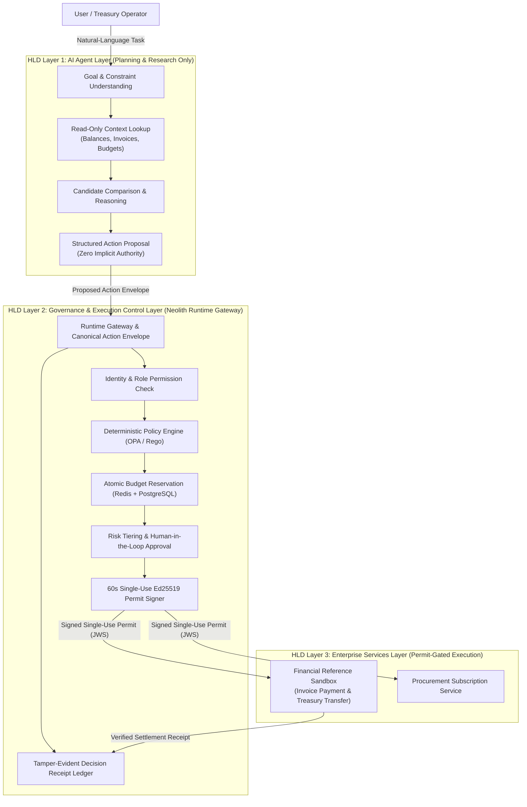
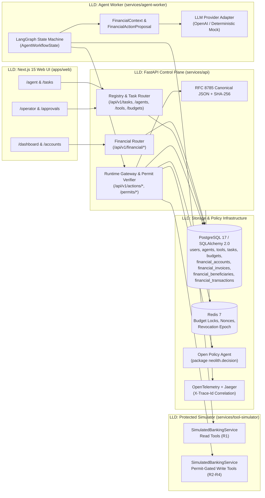
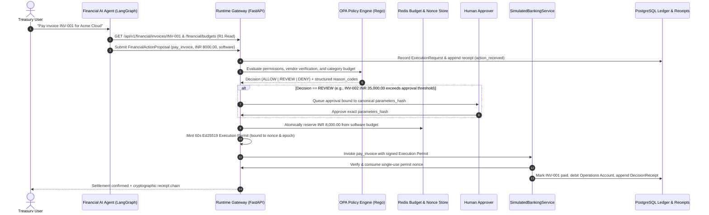
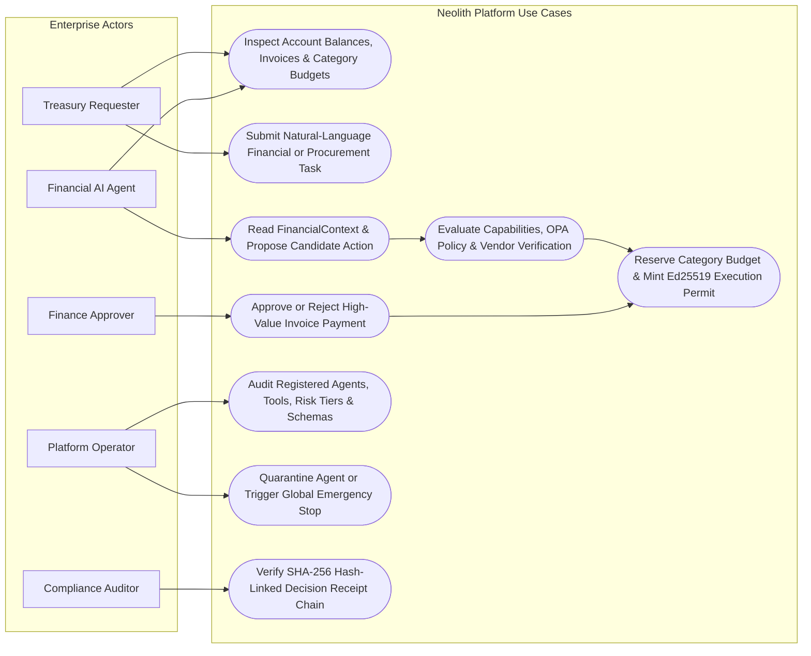

<div align="center">

# Neolith

### AI-Powered Agentic Decision and Execution System

**A Smart Governance Checkpoint Separating AI Agent Planning from Real-World Financial & Enterprise Execution**

[](https://www.python.org/)
[](https://fastapi.tiangolo.com/)
[](https://nextjs.org/)
[](https://www.typescriptlang.org/)
[](https://www.openpolicyagent.org/)
[](https://www.postgresql.org/)
[](https://redis.io/)

</div>

---

<h2 align="center">What is Neolith? (In Plain English)</h2>

Imagine hiring an **AI assistant** to help run your company's finance department. You want the AI to read invoices, check bank balances, compare software vendors, and prepare payments.

In most AI systems today, giving an AI the ability to pay an invoice means handing it the company credit card or direct banking API keys. **That is dangerous:**
- What if a fake invoice tricks the AI (**prompt injection**)?
- What if the AI hallucinates an extra zero and tries to pay **INR 80,000** instead of **INR 8,000**?
- What if two AI tasks run at the same time and accidentally spend more than the monthly budget?

**Neolith solves this by separating *thinking* from *doing*.**

Instead of giving the AI direct authority to move money or modify company systems, Neolith places a deterministic **Governance & Execution Control Plane** between the AI and the bank:

1. **The AI Agent Layer (The Planner)** — The AI can freely **read** balances, invoices, and budgets, and it can **propose** an action (for example: *"I recommend paying Invoice INV-001 for INR 8,000.00"*). However, the AI has **zero direct power** to execute that payment.
2. **The Governance Control Layer (The Security Checkpoint)** — Neolith's Runtime Gateway inspects the AI's proposal against strict deterministic rules (Open Policy Agent), locks the required budget in Redis so it cannot be double-spent, checks whether a human manager needs to approve it, and—only if every check passes—mints a **60-second, single-use digital pass (Ed25519 Execution Permit)**.
3. **The Enterprise Services Layer (The Vault)** — The banking or procurement system refuses to talk to the AI directly unless the AI presents that cryptographic single-use permit matching the exact payment amount and recipient. Every decision is permanently recorded in a tamper-evident **Decision Receipt chain**.

> **Core Principle:** *AI agents may understand, research, compare, and propose. Real-world execution requires independent, deterministic authority.*

---

<h2 align="center">System Architecture (HLD & LLD)</h2>

<h3 align="center">1. High-Level Design (HLD) — Three-Layer Governance Topology</h3>

The **High-Level Design (HLD)** illustrates how user intent flows through the **AI Agent Layer**, is independently verified by the **Governance & Execution Control Layer**, and is executed by **Protected Enterprise Services**.



---

<h3 align="center">2. Low-Level Design (LLD) — Service, Database & Protocol Component Topology</h3>

The **Low-Level Design (LLD)** shows the concrete runtime services, API routers, SQLAlchemy 2.0 / PostgreSQL tables, Redis atomic locks, and cryptographic verification boundaries inside the monorepo.



---

<h3 align="center">3. Low-Level Design (LLD) — Governed Financial Execution Sequence</h3>



---

<h2 align="center">Use Case Diagram</h2>



---

<h2 align="center">Financial Reference Application (Neolith Demo Corp)</h2>

While Neolith's governance control plane is general-purpose, the repository includes a complete **Financial Reference Application** (`services/api/src/neolith_api/financial/` and `services/tool-simulator/src/neolith_simulator/banking.py`) pre-seeded with deterministic enterprise treasury data for **Neolith Demo Corp**:

- **Primary Operating Account**: `Operations Account` — Available Balance: **`INR 100,000.00`** (`active`)
- **Monthly Category Budgets**:
  - `software`: **`INR 25,000.00`** limit (`INR 15,000.00` approval threshold)
  - `infrastructure`: **`INR 50,000.00`** limit (`INR 25,000.00` approval threshold)
  - `miscellaneous`: **`INR 10,000.00`** limit (`INR 5,000.00` approval threshold)

### Benchmark Invoices & Governance Outcomes

| Invoice # | Vendor Name | Amount (`INR`) | Category | Vendor Status | Expected Governance Outcome |
|:---:|---|---:|:---:|:---:|---|
| **`INV-001`** | **Acme Cloud** | `8,000.00` | `software` | `Verified` | **`ALLOW`** — Verified vendor and well within the `INR 25,000.00` software budget. |
| **`INV-002`** | **Nova Compute** | `35,000.00` | `infrastructure` | `Verified` | **`REVIEW`** — Within the `INR 50,000.00` infrastructure budget, but exceeds the `INR 25,000.00` single-payment approval threshold. |
| **`INV-003`** | **Unknown Supplies** | `75,000.00` | `miscellaneous` | `Unverified` | **`DENY`** — Blocked because the vendor is unverified and `INR 75,000.00` exceeds the `INR 10,000.00` miscellaneous budget. |

### Registered Financial Agent Tools (`financial-ai-agent`)

| Tool Name | Access Mode | Risk Tier | Capability | Description |
|---|:---:|:---:|---|---|
| `get_account_balance` | **Read-Only** | `R1` | `finance.account.read` | Inspect synthetic operating account balance (`INR`). |
| `list_transactions` | **Read-Only** | `R1` | `finance.transaction.read` | List recent treasury ledger transactions. |
| `get_invoice` | **Read-Only** | `R1` | `finance.invoice.read` | Retrieve vendor invoice details (`INV-001`, `INV-002`, `INV-003`). |
| `get_budget_status` | **Read-Only** | `R1` | `finance.budget.read` | Check monthly category budget limits, used spend, and remaining balance. |
| `get_beneficiary` | **Read-Only** | `R1` | `finance.beneficiary.read` | Check whether a vendor beneficiary is verified. |
| `pay_invoice` | **Protected Write** | `R2` | `finance.invoice.pay` | Settle an unpaid vendor invoice (**requires Runtime Gateway permit**). |
| `transfer_funds` | **Protected Write** | `R3` | `finance.funds.transfer` | Transfer funds to a registered beneficiary (**requires Runtime Gateway permit**). |
| `add_beneficiary` | **Protected Write** | `R4` | `finance.beneficiary.manage` | Register a new payment beneficiary (**requires Runtime Gateway permit**). |
| `cancel_payment` | **Protected Write** | `R2` | `finance.payment.cancel` | Cancel or compensate a pending payment (**requires Runtime Gateway permit**). |

---

<h2 align="center">Core Platform Features (F01–F16)</h2>

| ID | Feature Module | Description |
|:---:|---|---|
| **F01** | **User Task Workspace** | Structured workspace (`/tasks`, `/agent`) for goal submission, grounded context inspection, and status tracking. |
| **F02** | **Primary Agent Planning & Research** | Stateful LangGraph workflow that reads `FinancialContext` and emits typed `FinancialActionProposal` envelopes. |
| **F03** | **Runtime Gateway & Action Envelope** | Single mandatory entry point normalizing requests into RFC 8785 canonical JSON envelopes with idempotency enforcement. |
| **F04** | **Identity & Permission Validation** | Separates principal authentication, workload version verification, and RBAC/ABAC capability bindings from policy. |
| **F05** | **Deterministic Policy Engine** | Versioned Open Policy Agent (Rego v1) bundles producing structured `reason_codes` and required approval roles. |
| **F06** | **Transactional Budget & Quota Manager** | Authoritative category and task budgets using exact `Decimal` (`Numeric(18, 2)`) arithmetic and atomic reservations. |
| **F07** | **Multi-Signal Risk Analyzer** | Combines deterministic risk tiering (`R0`–`R4`) with semantic alignment signals that can escalate review but never override a hard deny. |
| **F08** | **Human Approval Workflow** | Durable workflow pause/resume where human sign-off is cryptographically bound to the exact canonical action hash. |
| **F09** | **Execution Permit Service** | Issues 60-second Ed25519-signed JWS permits bound to `tool_id`, `operation`, `parameters_hash`, `reservation_id`, and `revocation_epoch`. |
| **F10** | **Enterprise Service & MCP Connectors** | Read-only context tools paired with permit-enforcing protected service adapters (`SimulatedBankingService`). |
| **F11** | **Scoped Delegation & Multi-Agent** | Authority-narrowing delegation boundaries with maximum depth and budget ceiling enforcement. |
| **F12** | **Memory & Governed RAG** | Separates working task state, authoritative PostgreSQL records, and non-authoritative retrieval with untrusted content tagging. |
| **F13** | **Decision Receipts & Incidents** | Append-only SHA-256 hash-linked evidence chain (`previous_receipt_hash -> receipt_hash`) and incident timelines. |
| **F14** | **OpenTelemetry Observability** | End-to-end `X-Trace-Id` propagation, structured JSON logging, and Jaeger distributed tracing. |
| **F15** | **Evaluation & Assurance Lab** | Reproducible scenario harness testing happy paths, over-budget denials, prompt injection, permit replay, and emergency stops. |
| **F16** | **Financial & Procurement Reference Workflows** | Deterministic enterprise financial sandbox (`Neolith Demo Corp`) and procurement catalogue slice. |

---

<h2 align="center">Repository Structure</h2>

```text
Neolith/
├── apps/
│   └── web/                        # Next.js 15 App Router frontend + reusable enterprise UI library
│       └── src/
│           ├── app/                # Routes: /, /dashboard, /accounts, /agent, /tasks, /approvals, /operator
│           ├── components/         # AppShell, AgentTaskConsole & reusable UI primitives (Card, DataTable, BudgetMeter)
│           └── lib/                # Typed Financial & Platform API client with offline seed snapshot fallback
├── services/
│   ├── api/                        # FastAPI control plane, SQLAlchemy 2.0 ORM, Alembic migrations & seed module
│   │   ├── migrations/             # Alembic migration environment & Stage 1 initial revision
│   │   ├── src/neolith_api/        # Core ORM models, isolated financial sandbox, read/registry routers
│   │   └── tests/                  # Comprehensive pytest suite (health, readiness, financial sandbox, migrations)
│   ├── agent-worker/               # LangGraph agent state machine, FinancialContext & FinancialActionProposal contracts
│   └── tool-simulator/             # SimulatedBankingService (R1 read tools + permit-gated R2-R4 write stubs)
├── packages/
│   └── contracts/                  # Shared TypeScript contract interfaces & schema identifiers
├── policy/
│   ├── rego/neolith.rego           # Deterministic OPA Rego v1 decision policy
│   └── tests/neolith_test.rego     # Rego unit tests
├── specs/
│   ├── openapi.yaml                # OpenAPI 3.1.0 REST specification
│   ├── schemas/                    # JSON Schema Draft 2020-12 contracts
│   ├── sql/schema.sql              # Authoritative PostgreSQL 17 DDL schema
│   └── prompts/                    # Versioned runtime system prompts
├── evaluation/
│   └── scenarios/                  # 7 deterministic YAML assurance & adversarial test fixtures
├── infra/
│   └── docker-compose.yml          # Local PostgreSQL 17, Redis 7, OPA & Jaeger stack
├── scripts/
│   ├── check_docs.py               # Documentation & schema presence verifier
│   └── validate_contracts.py       # Comprehensive OpenAPI, JSON Schema, SQL & YAML validator
└── docs/                           # SRS, architecture, feature specs (F01-F16), Financial Reference App docs & rulebook
```

---

<h2 align="center">Self-Setup & Local Development Guide</h2>

### 1. Prerequisites

- **Python**: `3.12+`
- **Node.js**: `22.0+` with `pnpm` (`corepack enable pnpm`)
- **Docker Desktop**: Optional for local SQLite development; required for full PostgreSQL 17, Redis 7, Open Policy Agent, and Jaeger container stack
- **Git**: `2.40+`

### 2. Clone & Configure Environment

```cmd
git clone https://github.com/Dhruvg334/Neolith.git
cd Neolith
if not exist .secrets mkdir .secrets
if not exist .env copy .env.example .env
```

### 3. Start Local Infrastructure (PostgreSQL, Redis, OPA, Jaeger)

```cmd
docker compose -f infra\docker-compose.yml up -d
docker compose -f infra\docker-compose.yml ps
```

### 4. Backend Setup, Database Migration & Deterministic Seed (`services/api`)

```cmd
py -3.12 -m venv .venv
.venv\Scripts\python.exe -m pip install --upgrade pip
.venv\Scripts\python.exe -m pip install -e ".[dev]"
```

Run Alembic migrations and seed the deterministic Financial Reference Application dataset (`Neolith Demo Corp`):

```cmd
cd services\api
..\..\.venv\Scripts\python.exe -m alembic upgrade head
cd ..\..
.venv\Scripts\python.exe -m neolith_api.seed
```

Start the FastAPI server on `http://localhost:8000`:

```cmd
.venv\Scripts\python.exe -m uvicorn neolith_api.main:app --app-dir services\api\src --host 0.0.0.0 --port 8000 --reload
```

Verify the health, readiness, and financial sandbox endpoints:

```cmd
curl http://localhost:8000/api/v1/health
curl http://localhost:8000/api/v1/financial/summary
curl http://localhost:8000/api/v1/financial/invoices
curl http://localhost:8000/api/v1/financial/budgets
curl http://localhost:8000/api/v1/financial/tools
```

### 5. Frontend Setup & Verification (`apps/web`)

```cmd
pnpm install --frozen-lockfile
pnpm dev
```

Open `http://localhost:3000` in your browser to explore:
- `/` — System Overview & Three-Layer Governance Architecture
- `/dashboard` — Financial Dashboard (`INR 100,000.00` balance, unpaid invoices, monthly category budgets, recent transactions)
- `/accounts` — Accounts, Vendor Invoices (`INV-001`, `INV-002`, `INV-003`), Beneficiaries & Ledger
- `/agent` — Financial Agent Console (`financial-ai-agent`), `FinancialContext` inspector & tool permissions
- `/tasks` — Persisted Task Registry & Goal Intake
- `/operator` — Operator Control Plane (Registered Agents, `R1`–`R4` Tool Classifications, Budgets & Reason Codes)

### 6. Run Quality Gates, Contract Validators & Automated Tests

```cmd
:: Validate OpenAPI 3.1.0, JSON Schemas, SQL DDL, and Evaluation YAML fixtures
.venv\Scripts\python.exe scripts\check_docs.py
.venv\Scripts\python.exe scripts\validate_contracts.py

:: Run Python linter, formatter check, strict typecheck, and pytest suite
.venv\Scripts\python.exe -m ruff check .
.venv\Scripts\python.exe -m ruff format --check .
.venv\Scripts\python.exe -m mypy
.venv\Scripts\python.exe -m pytest -v

:: Run Frontend ESLint, TypeScript typecheck, and production build
pnpm lint
pnpm typecheck
pnpm build
```

---

<h2 align="center">Project Team & Academic Supervision</h2>

<div align="center">

Built as **Major Project - I** at **Kalinga Institute of Industrial Technology (KIIT University)**.

| Role | Name |
|---|---|
| **Project Guide & Supervisor** | **Prof. N Sangita Achary** |
| **Team Member** | **Dhruv Gupta** |
| **Team Member** | **Akkshita Isa** |
| **Team Member** | **Akshhaya Isa** |
| **Team Member** | **Shubhangini Mehta** |

</div>
