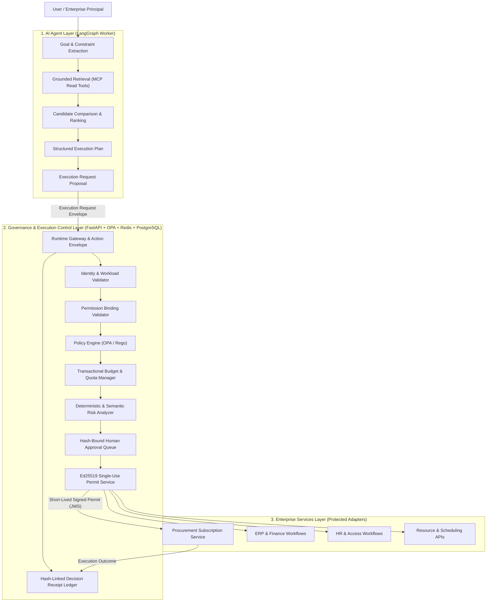
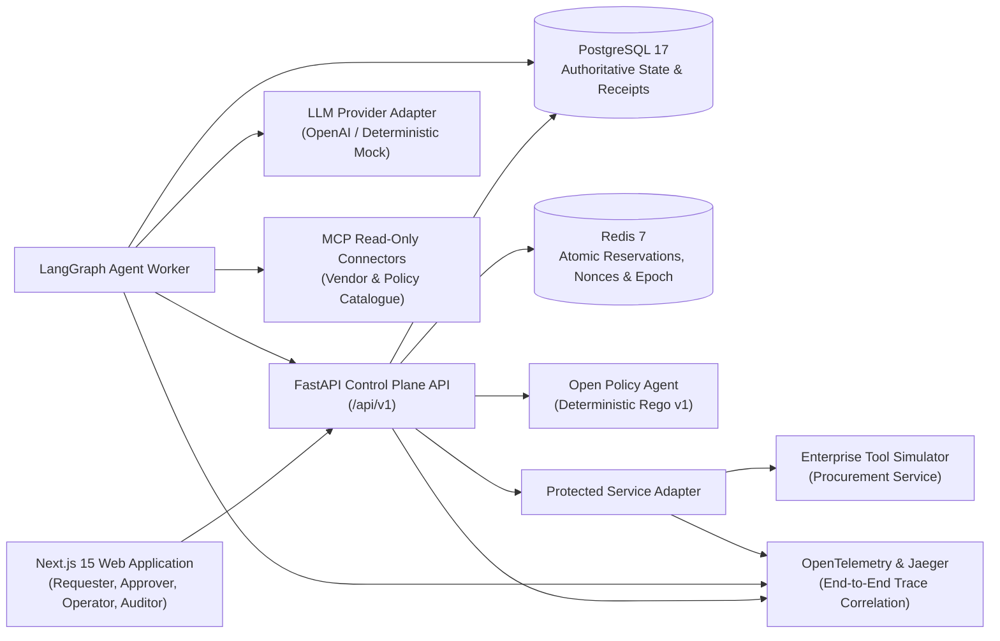
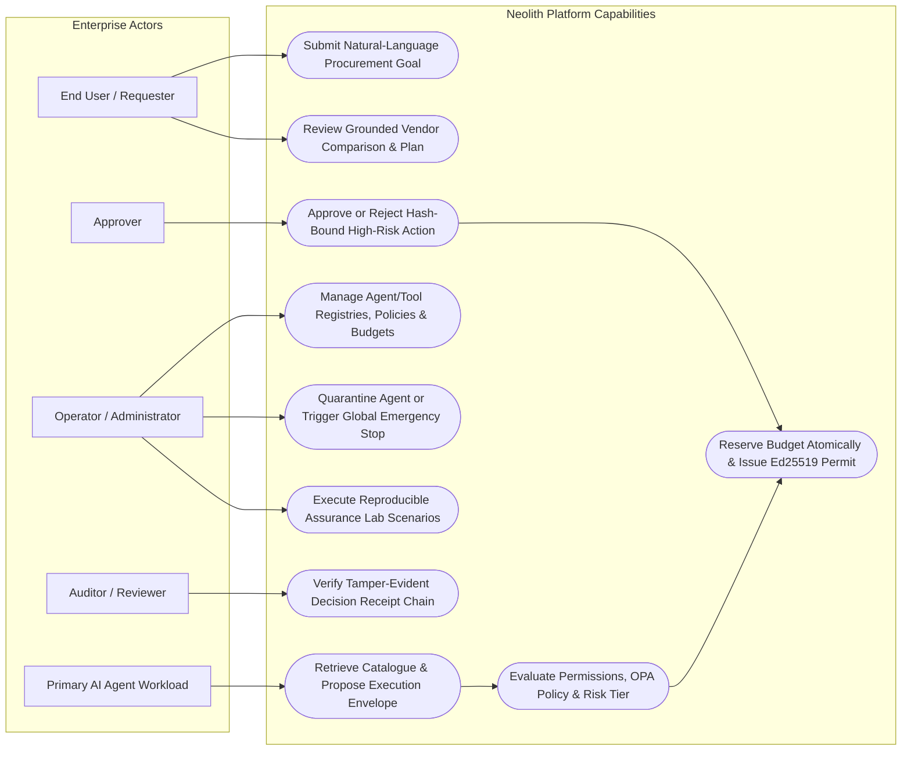
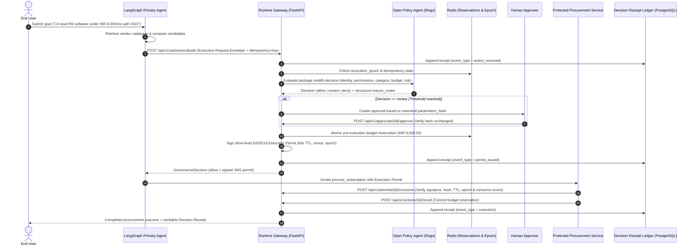

<div align="center">

# Neolith

### AI-Powered Agentic Decision and Execution System

**An Enterprise Control Plane Separating Autonomous Agent Intelligence from Deterministic Execution Authority**

[](https://www.python.org/)
[](https://fastapi.tiangolo.com/)
[](https://nextjs.org/)
[](https://www.typescriptlang.org/)
[](https://www.openpolicyagent.org/)
[](https://www.postgresql.org/)
[](https://redis.io/)

</div>

---

<h2 align="center">Overview</h2>

**Neolith** is an enterprise agentic AI decision and execution platform that enforces a strict architectural boundary between **intelligent planning** and **sensitive execution authority**.

In conventional agent deployments, language models are granted direct access to enterprise APIs and credentials, creating severe exposure to prompt injection, hallucinated parameters, concurrent budget overspend, and unverifiable side effects. Neolith resolves this by splitting the runtime into three isolated layers:

1. **AI Agent Layer** — Understands natural-language goals, extracts structured constraints, retrieves grounded enterprise and vendor data via Model Context Protocol (MCP) read tools, compares alternatives, and proposes canonical execution requests.
2. **Governance & Execution Control Layer** — Independently authenticates workloads, validates capability bindings, evaluates deterministic Open Policy Agent (OPA/Rego) rules, performs atomic pre-execution budget reservations in Redis, classifies risk tiers (`R0`–`R4`), orchestrates hash-bound human approvals, issues short-lived single-use Ed25519 Execution Permits, and appends SHA-256 hash-linked Decision Receipts.
3. **Enterprise Services Layer** — Rejects direct unpermitted calls and executes protected operations (such as software procurement, ERP, HR, CRM, and scheduling workflows) only after verifying a valid, unrevoked, single-use Execution Permit bound to the exact canonical parameter hash.

> **Core Invariant:** *Agents may understand, reason, compare, and propose. Sensitive execution requires independent deterministic authority.*

---

<h2 align="center">System Architecture</h2>

### Three-Layer Governance & Execution Topology



### Runtime Component Topology



---

<h2 align="center">Use Case Diagram</h2>



---

<h2 align="center">Governed Execution Sequence</h2>



---

<h2 align="center">Core Features & Capabilities</h2>

| ID | Feature Module | Description |
|:---:|---|---|
| **F01** | **User Task Workspace** | Structured 3-stage workspace for goal submission, grounded vendor comparison, governance status tracking, and receipt inspection. |
| **F02** | **Primary Agent Planning & Research** | Stateful LangGraph workflow that extracts constraints, queries approved sources with provenance, and emits structured proposals. |
| **F03** | **Runtime Gateway & Action Envelope** | Single mandatory entry point normalizing requests into RFC 8785 canonical JSON envelopes with idempotency enforcement. |
| **F04** | **Identity & Permission Validation** | Separates principal authentication, workload version verification, and RBAC/ABAC capability bindings from contextual policy. |
| **F05** | **Deterministic Policy Engine** | Versioned Open Policy Agent (Rego v1) bundles producing structured `reason_codes` and required approval roles. |
| **F06** | **Transactional Budget & Quota Manager** | Two-phase atomic Redis + PostgreSQL budget reservations (`pending -> reserved -> committed / released / reconciliation_required`) using exact `Decimal` arithmetic. |
| **F07** | **Multi-Signal Risk Analyzer** | Combines deterministic risk tiering (`R0`–`R4`) with semantic objective-alignment and velocity anomaly signals that can escalate review but never override a hard deny. |
| **F08** | **Human Approval Workflow** | Durable workflow pause/resume where human sign-off is cryptographically bound to the exact canonical action hash and expiration window. |
| **F09** | **Execution Permit Service** | Issues 60-second Ed25519-signed JWS permits bound to `tool_id`, `operation`, `parameters_hash`, `context_hash`, `reservation_id`, and `revocation_epoch`. |
| **F10** | **Enterprise Service & MCP Connectors** | Read-only MCP discovery tools paired with permit-enforcing protected service adapters and tool-manifest drift detection. |
| **F11** | **Scoped Delegation & Multi-Agent** | Authority-narrowing delegation boundaries with maximum depth and budget ceiling enforcement. |
| **F12** | **Memory & Governed RAG** | Separates working task state, authoritative PostgreSQL records, and non-authoritative semantic retrieval with untrusted content tagging. |
| **F13** | **Decision Receipts & Incidents** | Append-only SHA-256 hash-linked evidence chain (`previous_receipt_hash -> receipt_hash`) and security incident timelines. |
| **F14** | **OpenTelemetry Observability** | End-to-end `X-Trace-Id` propagation, structured JSON logging with secret redaction, and Jaeger distributed tracing. |
| **F15** | **Evaluation & Assurance Lab** | Reproducible scenario harness testing happy paths, over-budget denials, prompt injection, permit replay, parameter mutation, concurrency races, and emergency stops. |
| **F16** | **Procurement Demonstration Workflow** | Complete enterprise software procurement slice over a deterministic vendor catalogue (`TaskForge`, `PlanGridX`, `SprintDesk`). |

---

<h2 align="center">Repository Structure</h2>

```text
Neolith/
├── apps/
│   └── web/                        # Next.js 15 App Router frontend + reusable enterprise UI library
│       └── src/
│           ├── app/                # Routes: /, /tasks, /tasks/[id], /operator, /approvals, /receipts/[id]
│           └── components/
│               ├── AppShell.tsx    # Enterprise application shell & navigation
│               └── ui/             # Reusable UI primitives (Badge, Button, Card, DataTable, BudgetMeter, etc.)
├── services/
│   ├── api/                        # FastAPI control plane & governance runtime (/api/v1)
│   │   ├── src/neolith_api/        # Modular monolith: core, users, agents, tools, tasks, permissions,
│   │   │                           # policies, budgets, risk, approvals, actions, permits, executions,
│   │   │                           # receipts, revocations, incidents, evaluations, integrations
│   │   └── tests/                  # Automated unit, readiness, configuration, skeleton & contract tests
│   ├── agent-worker/               # LangGraph primary agent state machine & LLM provider adapter
│   └── tool-simulator/             # Permit-gated enterprise procurement service simulator
├── packages/
│   └── contracts/                  # Shared TypeScript contract interfaces & schema identifiers
├── policy/
│   ├── rego/neolith.rego           # Deterministic OPA Rego v1 decision policy
│   └── tests/neolith_test.rego     # Rego unit tests (allow, over-budget, permission missing, emergency stop)
├── specs/
│   ├── openapi.yaml                # OpenAPI 3.1.0 REST specification
│   ├── schemas/                    # JSON Schema Draft 2020-12 contracts (envelope, permit, receipt, task, policy)
│   ├── sql/schema.sql              # Authoritative PostgreSQL 17 DDL schema (25 tables)
│   └── prompts/                    # Versioned runtime system prompts
├── evaluation/
│   └── scenarios/                  # 7 deterministic YAML assurance & adversarial test fixtures
├── data/
│   └── fixtures/vendors.json       # Deterministic vendor catalogue fixture
├── infra/
│   └── docker-compose.yml          # Local PostgreSQL 17, Redis 7, OPA & Jaeger stack
├── scripts/
│   ├── bootstrap.cmd               # Windows environment bootstrap script
│   ├── check_docs.py               # Documentation & schema presence verifier
│   └── validate_contracts.py       # Comprehensive OpenAPI, JSON Schema, SQL & YAML validator
└── docs/                           # SRS, architecture, feature specs (F01-F16), test strategy & engineering rulebook
```

---

<h2 align="center">Self-Setup & Local Development Guide</h2>

### 1. Prerequisites

- **Python**: `3.12+`
- **Node.js**: `22.0+` with `pnpm` (`corepack enable pnpm`)
- **Docker Desktop**: Required for local PostgreSQL 17, Redis 7, Open Policy Agent, and Jaeger containers
- **Git**: `2.40+`

### 2. Clone & Configure Environment

```cmd
git clone https://github.com/Dhruvg334/Neolith.git
cd Neolith
if not exist .secrets mkdir .secrets
if not exist .env copy .env.example .env
```

### 3. Start Local Infrastructure (PostgreSQL, Redis, OPA, Jaeger)

```cmd
docker compose -f infra\docker-compose.yml up -d
docker compose -f infra\docker-compose.yml ps
```

- **PostgreSQL 17**: `localhost:5432` (automatically initializes `specs/sql/schema.sql`)
- **Redis 7**: `localhost:6379`
- **Open Policy Agent**: `http://localhost:8181/health`
- **Jaeger UI**: `http://localhost:16686`

### 4. Backend Setup & Verification (`services/api`)

```cmd
py -3.12 -m venv .venv
.venv\Scripts\python.exe -m pip install --upgrade pip
.venv\Scripts\python.exe -m pip install -e ".[dev]"
```

Run the backend API server on `http://localhost:8000`:

```cmd
.venv\Scripts\python.exe -m uvicorn neolith_api.main:app --app-dir services\api\src --host 0.0.0.0 --port 8000 --reload
```

Verify liveness and dependency readiness:

```cmd
curl http://localhost:8000/api/v1/health
curl http://localhost:8000/api/v1/ready
```

### 5. Frontend Setup & Verification (`apps/web`)

```cmd
pnpm install --frozen-lockfile
pnpm dev
```

Open `http://localhost:3000` in your browser to access:
- `/` — System Overview & Governed Execution Pipeline
- `/tasks` — Requester Task Workspace & Vendor Catalogue
- `/approvals` — Human-in-the-Loop Approval Queue
- `/operator` — Operator Control Plane, Budget Meter & Reason Code Dictionary

### 6. Run Quality Gates, Contract Validators & Tests

```cmd
:: Validate OpenAPI 3.1.0, JSON Schemas, SQL DDL, and Evaluation YAML fixtures
.venv\Scripts\python.exe scripts\check_docs.py
.venv\Scripts\python.exe scripts\validate_contracts.py

:: Run Python linter, formatter check, strict typecheck, and pytest suite
.venv\Scripts\python.exe -m ruff check .
.venv\Scripts\python.exe -m ruff format --check .
.venv\Scripts\python.exe -m mypy
.venv\Scripts\python.exe -m pytest -v

:: Run OPA Rego policy unit tests
docker run --rm -v "%cd%\policy:/policy:ro" openpolicyagent/opa:latest-static test /policy/rego /policy/tests -v

:: Run Frontend ESLint, TypeScript typecheck, and production build
pnpm lint
pnpm typecheck
pnpm build
```

---

<h2 align="center">Project Team & Academic Supervision</h2>

<div align="center">

Built as **Major Project - I** at **Kalinga Institute of Industrial Technology (KIIT University)**.

| Role | Name |
|---|---|
| **Project Guide & Supervisor** | **Prof. N Sangita Achary** |
| **Team Member** | **Dhruv Gupta** |
| **Team Member** | **Akkshita Isa** |
| **Team Member** | **Akshhaya Isa** |
| **Team Member** | **Shubhangini Mehta** |

</div>
