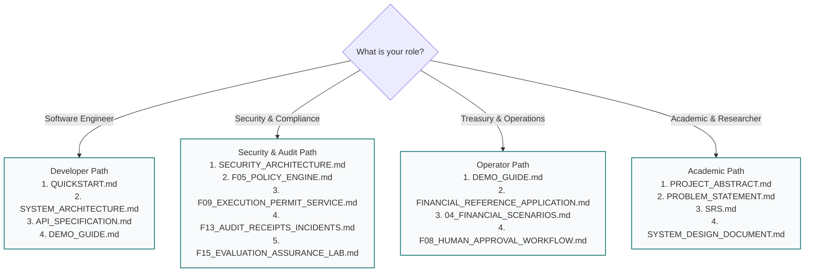

# Neolith Master Documentation Portal

Welcome to the **Neolith Documentation Portal**. Neolith is an **AI-Powered Agentic Decision and Execution System** that provides a deterministic governance control plane separating AI agent planning from real-world financial and enterprise execution.

---

## 🧭 Role-Based Reading Paths

Choose the reading path that fits your role to get productive immediately:

### 1. Developer & Integrator Path
If you are building, testing, or extending Neolith:
1. **[Quickstart Guide](QUICKSTART.md)** — Set up the local environment, run services, and verify all 12 quality gates in under 5 minutes.
2. **[Demo Walkthrough Guide](DEMO_GUIDE.md)** — Step-by-step instructions to run the reference financial scenarios (ALLOW, REVIEW, DENY).
3. **[System Architecture](design/SYSTEM_ARCHITECTURE.md)** — The 3-tier architecture separating Reasoning, Governance, and Enterprise Execution.
4. **[API Specification](design/API_SPECIFICATION.md)** — Complete REST contract specifications, schemas, and endpoint definitions.
5. **[Multi-Channel Interaction Interfaces](features/F17_MULTICHANNEL_INTERACTION_INTERFACES.md)** — How Web, WhatsApp, and Voice turns normalize into canonical interaction turns.
6. **[Cloud Deployment Guide](DEPLOYMENT.md)** — Production hosting on Vercel (Frontend) and Render Free (FastAPI + OPA + PostgreSQL).

### 2. Security, Risk & Compliance Path
If you are auditing system security, evaluating threat models, or configuring enterprise policies:
1. **[Security Architecture](design/SECURITY_ARCHITECTURE.md)** — Threat vectors, zero-ambient-authority posture, and defense-in-depth boundaries.
2. **[Policy Engine & OPA Rego](features/F05_POLICY_ENGINE.md)** — Declarative Rego policy evaluation and deterministic reason codes.
3. **[Execution Permit Service](features/F09_EXECUTION_PERMIT_SERVICE.md)** — 60-second single-use permits, nonces, and canonical SHA-256 parameter hashing.
4. **[Decision Receipts & Audit](features/F13_AUDIT_RECEIPTS_INCIDENTS.md)** — Tamper-evident SHA-256 cryptographic hash chain verifying immutable audit trails.
5. **[Security & Policy Assurance Lab](features/F15_EVALUATION_ASSURANCE_LAB.md)** — Repeatable evaluation suite testing 7 canonical safety invariants (prompt injection, permit replay, concurrency).

### 3. Treasury & Finance Operations Path
If you are managing company budgets, approving high-value invoices, or evaluating automated operations:
1. **[Demo Walkthrough Guide](DEMO_GUIDE.md)** — Try out the interactive financial agent, approvals queue, and operator kill-switch.
2. **[Financial Reference Application](context/FINANCIAL_REFERENCE_APPLICATION.md)** — The Accounts Payable domain model, double-entry ledger, and synthetic accounts.
3. **[Canonical Financial Scenarios](context/04_FINANCIAL_SCENARIOS.md)** — Concrete definitions of INV-001 (Routine SaaS), INV-002 (Infrastructure), and INV-003 (Unverified Vendor).
4. **[Human Approval Workflow](features/F08_HUMAN_APPROVAL_WORKFLOW.md)** — How the human-in-the-loop queue safeguards actions exceeding review thresholds.

### 4. Academic & Research Path
If you are evaluating this work in an academic or institutional context:
1. **[Project Abstract](academic/PROJECT_ABSTRACT.md)** — Summary of research goals, methodology, and core contributions.
2. **[Problem Statement](academic/PROBLEM_STATEMENT.md)** — The dangers of ambient authority in autonomous agentic systems.
3. **[Software Requirements Specification (SRS)](academic/SRS.md)** — Comprehensive IEEE-aligned formal requirements document.
4. **[System Design Document](academic/SYSTEM_DESIGN_DOCUMENT.md)** — Formal technical architecture, modular decomposition, and verification strategies.
5. **[Risks and Limitations](academic/RISKS_AND_LIMITATIONS.md)** — Explicit boundary analysis, assumptions, and failure modes.

---

## 📚 Complete Document Catalog

### Core Context & Domain Reference (`docs/context/`)
| Document | Summary |
|:---|:---|
| **[00_PROJECT_CONTEXT.md](context/00_PROJECT_CONTEXT.md)** | High-level project background, engineering mandate, and development milestones. |
| **[02_LOCKED_PRODUCT_PRINCIPLES.md](context/02_LOCKED_PRODUCT_PRINCIPLES.md)** | The non-negotiable principles: zero implicit authority, deterministic policy, and tamper-evident audit. |
| **[03_GLOSSARY.md](context/03_GLOSSARY.md)** | Definitions of key terms (Execution Permit, Revocation Epoch, Action Proposal, Governance Runtime). |
| **[04_FINANCIAL_SCENARIOS.md](context/04_FINANCIAL_SCENARIOS.md)** | The canonical demonstration scenarios: INV-001 (ALLOW), INV-002 (REVIEW), and INV-003 (DENY). |
| **[FINANCIAL_REFERENCE_APPLICATION.md](context/FINANCIAL_REFERENCE_APPLICATION.md)** | Complete Accounts Payable reference application specification, balance caps, and synthetic data. |

### Architectural Design Specifications (`docs/design/`)
| Document | Summary |
|:---|:---|
| **[SYSTEM_ARCHITECTURE.md](design/SYSTEM_ARCHITECTURE.md)** | Core 3-tier topology: AI Reasoning Layer, Governance Gateway, and Enterprise Services Layer. |
| **[COMPONENT_DESIGN.md](design/COMPONENT_DESIGN.md)** | Structural breakdown of backend modules, worker services, and UI components. |
| **[DATA_MODEL.md](design/DATA_MODEL.md)** | PostgreSQL relational schema: accounts, invoices, budgets, permits, decisions, and receipts. |
| **[STATE_MACHINES.md](design/STATE_MACHINES.md)** | Formal state machines for Tasks, Approvals, Permits, and Cluster System States. |
| **[API_SPECIFICATION.md](design/API_SPECIFICATION.md)** | OpenAPI 3.1.0 aligned endpoint specifications, request payloads, and typed response schemas. |
| **[SECURITY_ARCHITECTURE.md](design/SECURITY_ARCHITECTURE.md)** | Zero ambient authority, cryptographic hashing, monotonic epochs, and threat model. |
| **[DEPLOYMENT_ARCHITECTURE.md](design/DEPLOYMENT_ARCHITECTURE.md)** | Infrastructure topology: Next.js on Vercel, FastAPI + OPA on Render Free, PostgreSQL on Render. |
| **[INTERACTION_INTERFACE_ARCHITECTURE.md](design/INTERACTION_INTERFACE_ARCHITECTURE.md)** | Ingress normalization across Web, Twilio WhatsApp, and ElevenLabs Conversational Voice. |
| **[UI_UX_SPEC.md](design/UI_UX_SPEC.md)** | User experience standards, visual governance boundary styling (Accent Orange `#F97316`), and accessibility. |

### Feature Specifications (`docs/features/`)
| Feature ID | Title | Summary |
|:---|:---|:---|
| **[F00](features/00_FEATURE_INDEX.md)** | Feature Index | Master index of all 17 system features from F01 to F17. |
| **[F01](features/F01_USER_TASK_WORKSPACE.md)** | User Task Workspace | Goal intake, task lifecycle management, and natural language console. |
| **[F02](features/F02_PRIMARY_AGENT_PLANNING_RESEARCH.md)** | Primary Agent Planning & Research | LangGraph agent with structured intent extraction, balance lookups, and proposal creation. |
| **[F03](features/F03_RUNTIME_GATEWAY_ACTION_ENVELOPE.md)** | Runtime Gateway & Action Envelope | Canonical JSON envelope specification for proposed financial and system actions. |
| **[F04](features/F04_IDENTITY_PERMISSION_VALIDATION.md)** | Identity & Permission Validation | Cryptographic agent manifest verification and capability binding lookups. |
| **[F05](features/F05_POLICY_ENGINE.md)** | Policy Engine (OPA Rego) | Single policy authority evaluating declarative Rego rules with fail-closed security. |
| **[F06](features/F06_BUDGET_QUOTA_MANAGER.md)** | Budget & Quota Manager | Dynamic category spend ceilings, atomic reservations, and overdraft prevention. |
| **[F07](features/F07_RISK_ANALYZER.md)** | Risk Analyzer | Risk classification (R0 read-only context to R4 critical mutations) and anomaly scoring. |
| **[F08](features/F08_HUMAN_APPROVAL_WORKFLOW.md)** | Human Approval Workflow | Dedicated human review queue (`/approvals`) for actions exceeding category thresholds. |
| **[F09](features/F09_EXECUTION_PERMIT_SERVICE.md)** | Execution Permit Service | Short-lived (60s), single-use cryptographic permits with parameter tampering detection. |
| **[F10](features/F10_ENTERPRISE_SERVICE_MCP_CONNECTORS.md)** | Enterprise Service Connectors | Protected banking execution simulator enforcing permit presentation before disbursements. |
| **[F11](features/F11_DELEGATION_MULTI_AGENT.md)** | Multi-Agent Delegation | Governed sub-agent delegation maintaining zero privilege escalation. |
| **[F12](features/F12_MEMORY_GOVERNED_RAG.md)** | Governed Memory & Context | Session state and multi-turn conversational memory isolated across tenants. |
| **[F13](features/F13_AUDIT_RECEIPTS_INCIDENTS.md)** | Tamper-Evident Decision Receipts | Cryptographic append-only hash chain permanently recording every governance decision. |
| **[F14](features/F14_OBSERVABILITY_LOGGING_DEBUGGING.md)** | Observability & Telemetry | Structured distributed tracing (`trace_id`), latency monitoring, and audit logs. |
| **[F15](features/F15_EVALUATION_ASSURANCE_LAB.md)** | Security & Policy Assurance Lab | Automated runner for 7 canonical safety scenarios with database reporting. |
| **[F16](features/F16_FINANCIAL_REFERENCE_APPLICATION.md)** | Financial Reference Application | Synthetic accounts, invoices, beneficiaries, and double-entry transaction ledgers. |
| **[F17](features/F17_MULTICHANNEL_INTERACTION_INTERFACES.md)** | Multi-Channel Interaction Core | Parity across Web (`/agent`), WhatsApp (Twilio), and Voice (ElevenLabs SSE). |

### Testing & Verification (`docs/testing/`)
| Document | Summary |
|:---|:---|
| **[TEST_STRATEGY.md](testing/TEST_STRATEGY.md)** | Quality strategy spanning unit tests, integration suites, OPA policy tests, and frontend gates. |
| **[ACCEPTANCE_TEST_MATRIX.md](testing/ACCEPTANCE_TEST_MATRIX.md)** | Traceability matrix mapping system requirements to automated test cases. |
| **[EVALUATION_PLAN.md](testing/EVALUATION_PLAN.md)** | Adversarial test plan verifying prompt injection defense, replay prevention, and concurrency. |

---

## 🌐 Web Application Route Map

| URL Route | Interface Name | Purpose |
|:---|:---|:---|
| **`/`** | Landing Page | Enterprise overview, traditional agent vs. Neolith comparison, and 4-step lifecycle. |
| **`/dashboard`** | Treasury Dashboard | Balance metrics (INR 100,000.00), unpaid invoice counters, category spend meters, ledger. |
| **`/accounts`** | Accounts & Invoices | Accounts, invoices (INV-001, INV-002, INV-003), beneficiaries, and transaction history. |
| **`/agent`** | Financial Agent Console | Natural language chat interface with visual governance boundaries and proposal inspector. |
| **`/approvals`** | Approvals Queue | Human review checkpoint queue with canonical action parameter inspector and one-click execution. |
| **`/operator`** | Operator Control Plane | Cluster emergency stop, agent quarantine toggles, and live F15 Assurance Lab runner. |
| **`/receipts/[id]`** | Decision Receipt Explorer | Visual cryptographic receipt explorer with chain index, parent hash, and live verification. |
| **`/governance`** | Governance Workspace | Live decision telemetry, outcome distributions, active profile banner, and audit drawer. |
| **`/policies`** | Policy Profile Manager | Dynamic profile switcher (Strict, Balanced, High Autonomy) and custom policy threshold builder. |
| **`/docs`** | Documentation Hub | Interactive Documentation Hub with 10 zoomable Mermaid architecture diagrams. |
| **`/adopt`** | Enterprise Adoption Guide | Phased 10-step enterprise rollout guide from discovery to zero-ambient-authority go-live. |
| **`/security`** | Security Architecture | Invariant specifications, threat model, and defense-in-depth boundaries. |
| **`/privacy` & `/terms`**| Legal & Trust | Enterprise data privacy policies and terms of service. |
| **`/llms.txt`** | Machine-Readable Docs | Plaintext system overview optimized for LLMs and developer discovery. |
