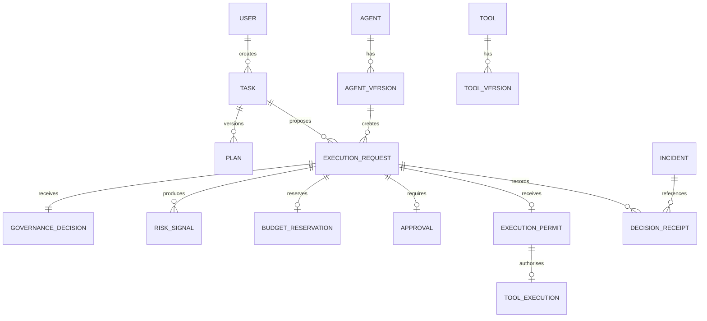

# Data Model

## Core entities

### User
Requester or operator identity.

### Agent
Logical AI agent.

### AgentVersion
Immutable agent deployment manifest.

### Tool
Logical capability exposed to agent.

### ToolVersion
Immutable tool description/schema/endpoint.

### Task
User goal and workflow state.

### Plan
Structured agent plan version.

### PermissionBinding
Capability assigned to role/user/agent.

### Policy
Logical organisational policy.

### PolicyVersion
Immutable Rego bundle/version.

### Budget
Financial or resource limit.

### BudgetReservation
Pre-execution allocation.

### ExecutionRequest
Canonical protected action.

### GovernanceDecision
Allow, deny, review or allow-with-constraints.

### RiskSignal
Deterministic or learned risk evidence.

### Approval
Human decision bound to exact action hash.

### ExecutionPermit
Signed short-lived action capability.

### ToolExecution
Protected service result.

### DecisionReceipt
Append-only evidence event.

### Revocation
Scoped stop/revocation record.

### Incident
Security/governance event timeline.

### EvaluationSuite / Case / Run / Result
Assurance harness records.

## Relationship overview

## Invariants

- protected execution request references a registered agent version;
- permission/policy decision is independent of model text;
- monetary request uses decimal amount;
- permit maps to exactly one execution request;
- permit is immutable after issue;
- active policy version is immutable;
- finalised receipt is append-only;
- revocation epoch only increases;
- task memory cannot create a permission record.
