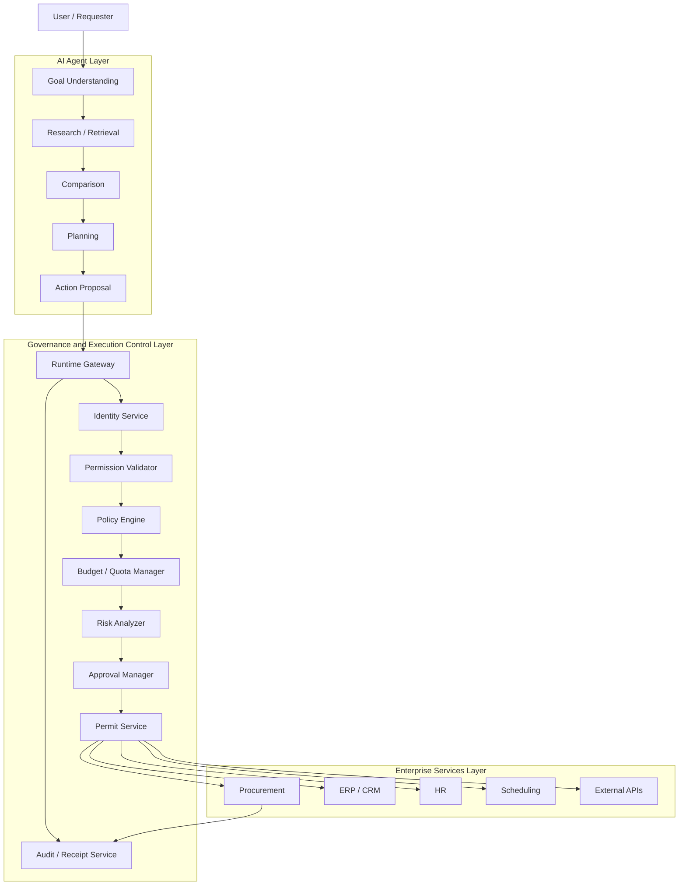
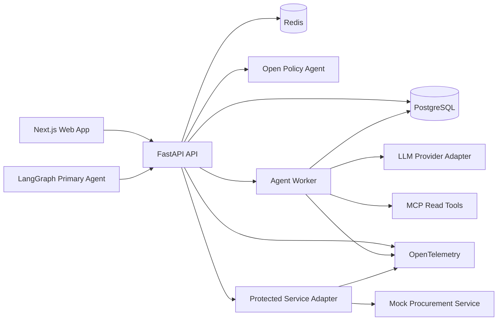

# System Architecture

## 1. Architecture style

Neolith uses a modular backend with separate agent and policy runtimes.

For the semester prototype:

- one FastAPI application contains core control-plane and governance modules;
- one LangGraph worker executes long-running agent workflows;
- OPA runs separately as deterministic policy engine;
- PostgreSQL is authoritative state;
- Redis handles low-latency reservations, idempotency and revocation state;
- protected enterprise services run as a mock service;
- Next.js provides user and operator interfaces.

This avoids premature microservices while keeping clear boundaries.

## 2. Three-layer academic view



## 3. Implementation view



## 4. Backend modules

```text
neolith/
├─ core/
│  ├─ config
│  ├─ security
│  ├─ errors
│  ├─ idempotency
│  └─ telemetry
├─ users/
├─ agents/
├─ tools/
├─ tasks/
├─ permissions/
├─ policies/
├─ budgets/
├─ risk/
├─ approvals/
├─ actions/
├─ permits/
├─ executions/
├─ receipts/
├─ revocations/
├─ incidents/
├─ evaluations/
└─ integrations/
```

## 5. Protected action sequence

```text
Agent proposes action
→ Runtime Gateway validates envelope
→ Agent/workload identity verified
→ Permission checked
→ Policy evaluated by OPA
→ Risk classified
→ Budget/quota reserved if required
→ Human approval if required
→ Decision persisted
→ Signed permit issued
→ Protected service verifies permit
→ Action executes
→ Reservation commits/releases
→ Decision receipt appended
```

## 6. Design boundaries

### AI Agent Layer owns

- language interpretation;
- retrieval;
- comparison;
- plan;
- recommendation;
- proposal.

### Governance Layer owns

- identity;
- permissions;
- policy;
- budget/quota;
- risk thresholding;
- approvals;
- permits;
- revocation;
- evidence.

### Enterprise Service owns

- actual business side effect;
- business-level idempotency;
- result reporting;
- compensation where supported.

## 7. Extension model

A new enterprise workflow should add:

1. new tool/service adapter;
2. permissions;
3. policy rules;
4. action schema;
5. risk classification;
6. evaluation scenarios;
7. UI where necessary.

The governance core should not need redesign.
