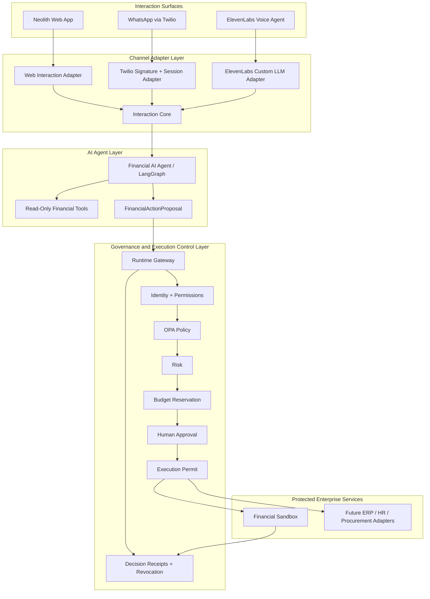
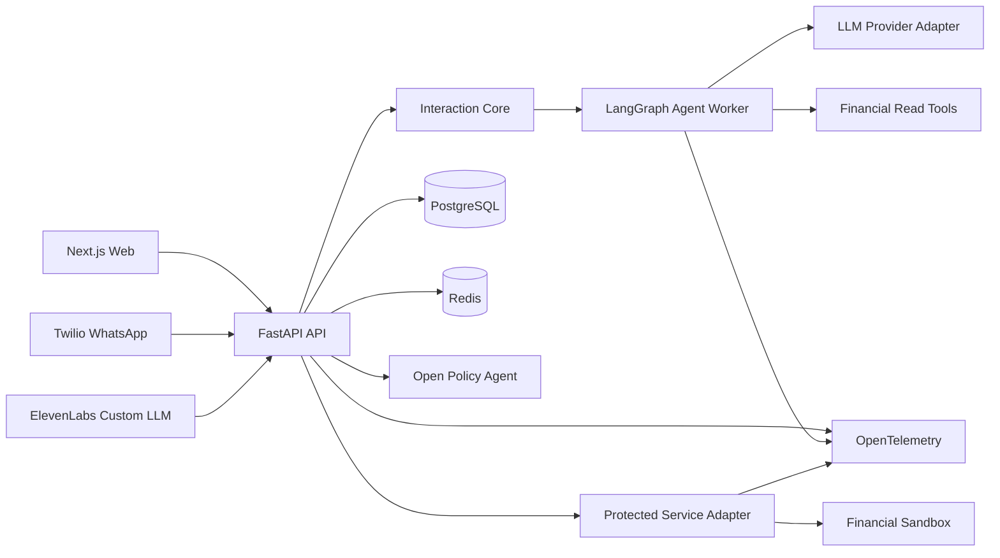

# System Architecture

## 1. Architecture style

Neolith uses a modular backend with separate agent and policy runtimes.

For the semester implementation:

- one FastAPI application contains the core control-plane, interaction and governance modules;
- one LangGraph worker executes stateful Financial AI Agent workflows;
- OPA runs separately as deterministic policy engine;
- PostgreSQL is authoritative state;
- Redis handles low-latency reservations, idempotency, channel work coordination and revocation state;
- protected enterprise services run as simulators;
- Next.js provides the inspectable Web interface;
- Twilio WhatsApp and ElevenLabs Voice are additional channel adapters into the same Financial AI Agent.

This avoids premature microservices while preserving clear security and integration boundaries.

## 2. High-level architecture



## 3. Interface invariants

1. Web, WhatsApp and Voice use one Financial AI Agent workflow.
2. Channel adapters authenticate/normalise transport but do not decide financial authority.
3. WhatsApp sender identity is not automatically a Neolith finance permission.
4. ElevenLabs is a voice client of Neolith, not a direct protected-tool authority.
5. Protected financial writes still require the Runtime Gateway and later execution permit.
6. Equivalent requests across interfaces should generate equivalent structured proposals before governance.

See `docs/design/INTERACTION_INTERFACE_ARCHITECTURE.md`.

## 4. Implementation view



## 5. FastAPI modules

```text
neolith_api/
├─ core/
├─ users/
├─ agents/
├─ tools/
├─ tasks/
├─ interactions/          # channel-neutral sessions and turns
├─ integrations/
│  ├─ twilio/             # WhatsApp adapter
│  └─ elevenlabs/         # voice/custom-LLM adapter
├─ financial/             # reference-application read APIs/domain
├─ permissions/
├─ policies/
├─ budgets/
├─ risk/
├─ approvals/
├─ actions/
├─ permits/
├─ executions/
├─ receipts/
├─ revocations/
├─ incidents/
└─ evaluations/
```

## 6. Protected action sequence

```text
Financial AI Agent proposes action
→ Runtime Gateway validates envelope
→ Agent/workload identity verified
→ User/agent permissions checked
→ OPA policy evaluated
→ Risk classified
→ Budget reserved if required
→ Human approval if required
→ Decision persisted
→ Signed permit issued
→ Protected financial service verifies permit
→ Action executes
→ Reservation commits/releases
→ Decision Receipt appended
```

The user interface that originated the request does not change this sequence.

## 7. Extension model

A new interface adds a channel adapter that produces `InteractionTurn` and consumes `InterfaceResponse`.

A new enterprise workflow adds:

1. tool/service adapter;
2. permissions;
3. policy rules;
4. action schema;
5. risk classification;
6. evaluation scenarios;
7. UI where necessary.

The governance core should not need redesign.
